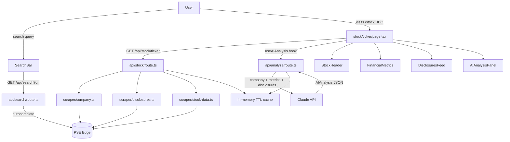

## PSEi Stock Research App — Architecture

## Data Flow Rules
- Scraping: server-side only (API routes) — never in components or hooks
- Components: pure presentational, no fetch calls
- Hooks (useStockSearch, useAIAnalysis): client-side fetch to API routes only
- Cache sits between API routes and PSE Edge — check before scraping
- AI receives: company profile + financial metrics + disclosure titles (last 30 days, truncated to 500 chars)
