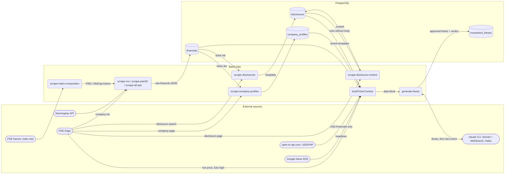
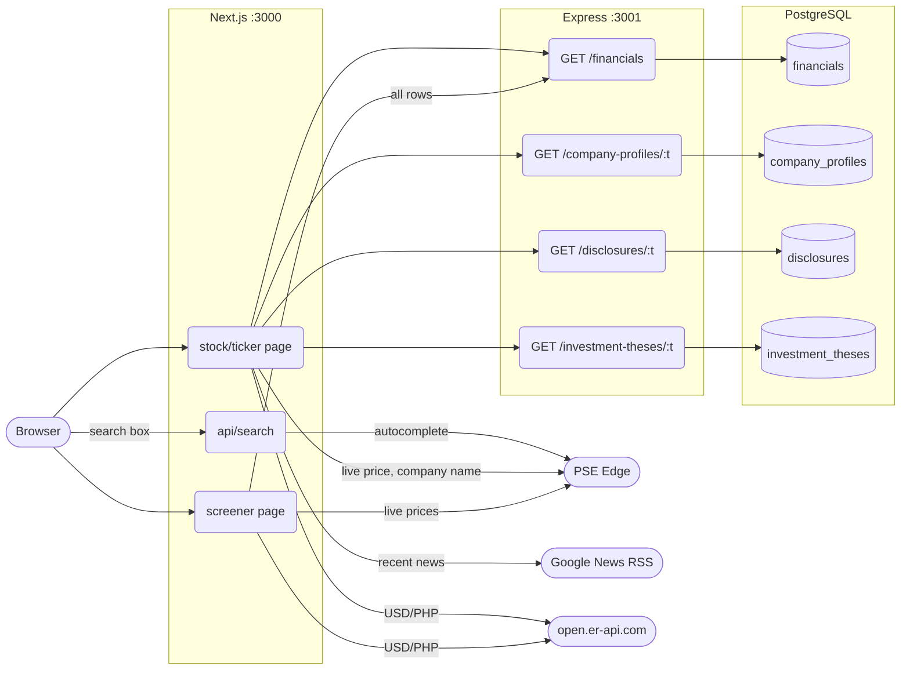
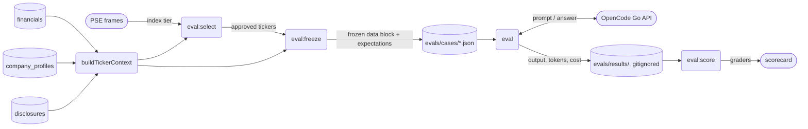

# Data Pipeline: Data Flow

How data enters the system, where it is stored, and what reads it. Shapes: `([source])` external service, `(process)` script or route, `[(store)]` PostgreSQL table or file.

## 1. Batch ingestion and thesis generation

Scripts in `server/scripts/`, run by hand (`pnpm <script>` in `server/`). They fill PostgreSQL; the web app never scrapes history at request time.

**Watch the PSE Edge company lookup.** `PROF`, `DISC`, `CTX` and the web app all resolve a ticker to a PSE Edge company ID first. When that lookup matched the wrong company (fixed in INV-11 with an exact symbol match), the error spread to every table downstream. Rows scraped before the fix were re-scraped in INV-13.

## 2. Web app requests

Next.js server components read stored data through Express and fetch live price and news directly. Client components never fetch or scrape.

## 3. Model evals

`server/evals/` freezes the same thesis input production builds, so every model sees identical data.

## Lineage table

| Table / file | Written by | Read by |
|---|---|---|
| `financials` | Morningstar scrape jobs | profiles and disclosures jobs (ticker list), `buildTickerContext`, `GET /financials` (dashboard, screener) |
| `company_profiles` | `scrape-company-profiles` | `buildTickerContext`, `GET /company-profiles/:t` |
| `disclosures` | `scrape-disclosures` (metadata), `scrape-disclosure-content` (body) | `buildTickerContext` (recent templates), `GET /disclosures/:t` |
| `investment_theses` | `generate-thesis` (after fact-check + sanity check) | `GET /investment-theses/:t` (dashboard) |
| `evals/cases/` | `eval:freeze` | `eval` |
| `evals/results/` | `eval` | `eval:score` |

Not stored (fetched live each time): prices and 52-week highs (PSE Edge), news headlines (Google News), USD/PHP rate. The `company` and `news` tables are legacy and unused by current code.
