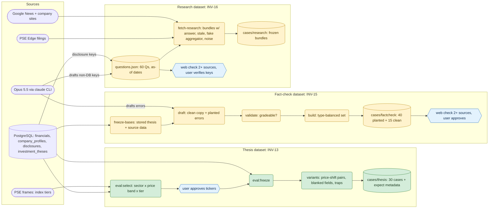
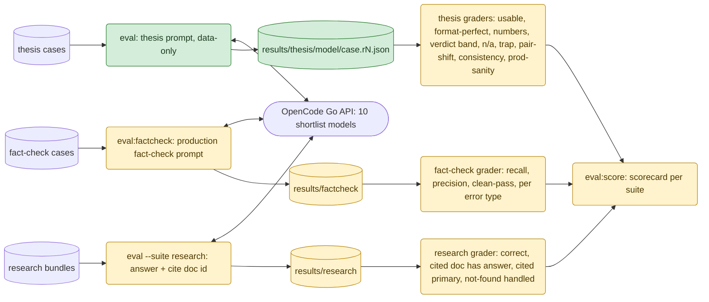
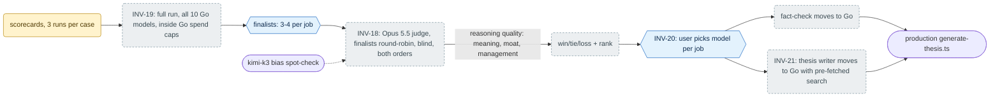

# Model Eval: Data Flow

How `server/evals/` picks an OpenCode Go model for each AI job in the app: thesis writing, fact-check, and reading research. Claude models are not candidates (production won't run behind the `claude` CLI); Opus 5.5 is used only to draft datasets and to judge.

Status colors: **green** merged on `main`, **yellow** open PR, **grey dashed** planned ticket, **blue hexagon** step that needs the user.

## 1. Datasets: built once, frozen, reviewed

## 2. Runs and grading: every candidate model, same frozen input

Format grading (`usable`, `format-perfect`) is merged; the content graders in the thesis box are PR #20. Every run records tokens, cost and latency next to the output.

## 3. Picking a model per job

The judge only scores what scripts can't: the quality of the investment reasoning. Everything else is graded by code, so answer keys come from the database, primary sources, or user sign-off, never from a model alone.
