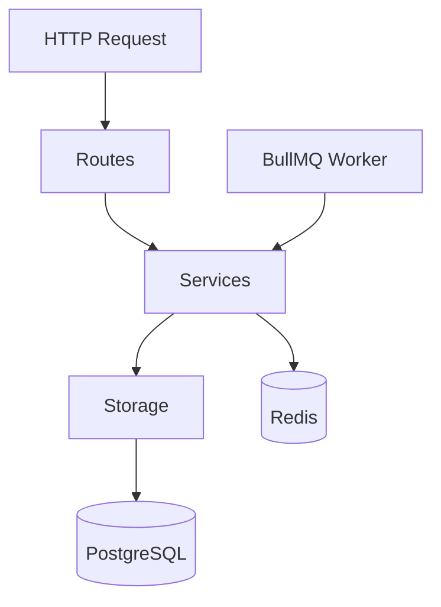

# CLAUDE.md — [Project Name]

## Stack

- **Runtime**: Node.js + TypeScript (ESM)
- **Framework**: Express / Fastify
- **DB**: PostgreSQL (Drizzle ORM)
- **Queue**: BullMQ + Redis
- **Auth**: [e.g., JWT / session-based]
- **Deployment**: [e.g., AWS / Railway]

## Key Commands

```bash
npm run dev          # start dev server
npm run build        # compile TS
npm run test         # run tests
npm run lint         # ESLint
npm run typecheck    # tsc --noEmit
npm run migrate      # run DB migrations
npm run generate     # generate migration files
```

## Architecture

```
src/
  routes/      # HTTP layer only — no business logic
  services/    # Business logic — imports from storage directly
  storage/     # DB queries — pure data access
  workers/     # BullMQ job processors
  lib/         # Shared utilities
```

**Rules:**
- Routes → Services → Storage (one-way dependency)
- No barrel exports (`index.ts` re-exports)
- Services never import other services directly — use composition at route level
- Storage layer never throws HTTP errors — throw domain errors only

## Code Style

- ESM imports only (`import`, not `require`)
- Destructure imports when possible
- Explicit return types on all exported functions
- Zod for all external input validation (HTTP bodies, env vars, queue payloads)
- No `any` — use `unknown` and narrow
- Prefer `const`, avoid `let` unless mutation is necessary

## Database Conventions

- Snake_case column names
- All tables have `id` (uuid), `created_at`, `updated_at`
- Migrations are append-only — never edit existing migrations
- ETL scripts: `generate.ts` produces per-org SQL files, `migrate.ts` executes them

## Testing

- Jest / Vitest
- Test behavior, not implementation
- Integration tests use a test DB (never mock the DB layer)
- Factories for test data — no hardcoded IDs
- Run `npm run typecheck && npm run test` before every PR

## Git

- Commit after every meaningful working state
- Commit messages: concise, imperative, sacrifice grammar for brevity
- Never use `--no-verify`
- Branch naming: `feat/`, `fix/`, `chore/`, `refactor/`

## What NOT To Do

- Never `--no-verify` to bypass hooks
- Never disable tests instead of fixing them
- Never commit code that doesn't compile
- Never add TODO without a linked issue number
- Never introduce new dependencies without discussion
- Never mutate request/response objects across middleware layers
- Never write raw SQL outside the storage layer
- Never expose internal error details in HTTP responses

## System Diagrams



## Unresolved Questions Protocol

At the end of every plan, list unresolved questions. Format:
```
Unresolved:
- [question 1]?
- [question 2]?
```
Concise. Sacrifice grammar.

## Session Instructions

- Be extremely concise in all responses and commit messages
- Sacrifice grammar for concision
- When stuck after 3 attempts: stop, document what failed, ask
- Never use `--dangerously-skip-permissions`
