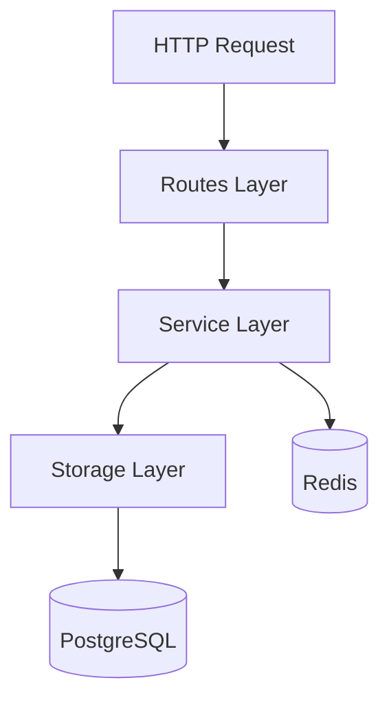

# Claude Code Power User Notes

## Planning & Task Decomposition

- **Always use Plan Mode first** (Shift+Tab to toggle)
  - Break large tasks into discrete, independently verifiable phases
  - At end of every plan, Claude outputs: **unresolved questions list** (concise, grammar sacrificed)
  - Save the plan externally (e.g., `IMPLEMENTATION_PLAN.md`) before starting execution
  - `/clear` context after saving plan — free tokens for implementation phase
  - Treat each phase as a separate session with its own focused context

- **What makes a good plan prompt:**
  - State the goal + constraints upfront
  - Reference relevant files with `@filename`
  - Mention what NOT to do (avoid breaking X, don't introduce Y)

---

## Memory & CLAUDE.md

Three levels — know which to use:

| Level | File | Scope |
|---|---|---|
| Global | `~/.claude/CLAUDE.md` | All projects |
| Project | `.claude/CLAUDE.md` | This repo only |
| Local | `.claude/settings.local.json` | Personal, not committed |

Edit via `/memory` command in Claude Code.

**Global memory instructions (add to `~/.claude/CLAUDE.md`):**
```
In all interactions and commit messages, be extremely concise. Sacrifice grammar for concision.
At the end of each plan, give me a list of unresolved questions, if any. Concise. Sacrifice grammar.
```

**Project CLAUDE.md** should include:
- Build/test/lint/typecheck commands
- Stack: Node.js, TypeScript, PostgreSQL, Redis, Drizzle/Prisma
- Architectural rules (modular monolith: storage → service → routes, no barrel exports)
- What NOT to do (never `--no-verify`, never disable tests, never commit broken builds)
- Mermaid diagrams of core system flows (feed at session start)

---

## Context Window Management

- `/clear` aggressively — start each new task fresh
- Use `!command` prefix to run bash inline (no tokens wasted asking Claude to run it)
  - `!git status`, `!npm test`, `!tail -50 app.log`
- MCP tools eat 8–30% of context just by being loaded — remove unused ones
- For large tasks: plan → save plan → `/clear` → implement phase 1 → commit → `/clear` → phase 2

---

## Session Workflows

```fish
# Resume last session
claude --continue

# Pick from recent sessions
claude --resume

# Headless / pipe mode
git diff | claude -p "summarize changes for PR description"
cat error.log | claude -p "diagnose and suggest fixes"
claude -p "fix lint errors"
```

**Name your sessions** with `/rename` → e.g., `"auth-migration"`, `"pg-v3-etl"`, `"bullmq-queue-refactor"`

**Fish aliases to add (`~/.config/fish/config.fish`):**
```fish
# Open Claude Code in current project
alias cc="claude"

# Claude with a Mermaid diagram pre-loaded in context
alias ccarch="claude --append-system-prompt \"\$(cat .claude/diagrams/architecture.md)\""

# Resume last session
alias ccr="claude --continue"

# Headless git diff summary
alias ccdiff="git diff | claude -p 'summarize changes for PR description'"
```

---

## Hooks (`.claude/settings.json`)

Hooks = **deterministic enforcement**. Turn "please do X" into a guaranteed action.

> Key insight: format on `Stop` (session end), not `PostToolUse` — avoids context bloat from repeated system reminders about file changes.

```json
{
  "hooks": {
    "PostToolUse": [
      {
        "matcher": "Edit|Write|MultiEdit",
        "hooks": [{
          "type": "command",
          "command": "if [[ \"$CLAUDE_FILE_PATHS\" =~ \\.(ts|tsx)$ ]]; then npx tsc --noEmit --skipLibCheck 2>&1 || echo '⚠️ TS errors'; fi"
        }]
      }
    ],
    "Stop": [
      {
        "matcher": "",
        "hooks": [
          {
            "type": "command",
            "command": "npm run lint --silent 2>&1 && npm run typecheck --silent 2>&1 && echo '✅ Clean — committing' && git add -A && git commit -m 'chore: claude session checkpoint' || echo '❌ Lint/type errors — fix before commit'"
          }
        ]
      }
    ],
    "SessionStart": [
      {
        "matcher": "",
        "hooks": [{
          "type": "command",
          "command": "echo \"Git status: $(git status --short)\" && echo \"Branch: $(git branch --show-current)\""
        }]
      }
    ]
  }
}
```

**Hook events cheatsheet:**
| Event | When | Use for |
|---|---|---|
| `SessionStart` | Session opens | Inject git status, load diagrams |
| `PreToolUse` | Before any tool | Block dangerous commands |
| `PostToolUse` | After file edit | TypeScript check |
| `Stop` | Session ends | Lint → typecheck → commit |
| `UserPromptSubmit` | Before Claude sees prompt | Inject extra context |

---

## MCP Servers (Priority Stack for Backend Dev)

Install with: `claude mcp add <name> <command>`

| MCP | Value | Install |
|---|---|---|
| **GitHub** | PRs, issues, CI — never leave terminal | `claude mcp add github npx @modelcontextprotocol/server-github` |
| **PostgreSQL** | Query DB in natural language mid-session | `claude mcp add postgres npx @modelcontextprotocol/server-postgres` |
| **Context7** | Up-to-date library docs (kills hallucinations on new APIs) | `claude mcp add context7 npx @context7/mcp` |
| **Sequential Thinking** | Forces structured reasoning on complex arch decisions | `claude mcp add sequential-thinking npx @modelcontextprotocol/server-sequential-thinking` |

> Keep active MCPs to 2–3 max. Each one burns context. Swap based on task.

---

## Custom Slash Commands (`.claude/commands/`)

Create `.md` files — natural language, use `$ARGUMENTS` for dynamic input.

```
.claude/commands/
  review.md       → "Review $ARGUMENTS for: correctness, edge cases, TS types, SQL injection risk"
  migrate.md      → "Generate migration for: $ARGUMENTS. Follow our ETL pattern (generate.ts + migrate.ts)"
  pr.md           → "Write PR description for current git diff. Concise. Include: what changed, why, risks."
  explain.md      → "Explain $ARGUMENTS as if I'm unfamiliar with this part of the codebase"
```

Usage: `/review src/services/auth.ts`

---

## Mermaid Diagrams as Context

Store in `.claude/diagrams/`. Feed at session start for architecture-heavy tasks.

```markdown
<!-- .claude/diagrams/architecture.md -->
## System Flow

```

Reference with `@.claude/diagrams/architecture.md` at session start, or via the `ccarch` alias.

---

## llms.txt

Some libraries expose `/llms.txt` — a file designed for AI consumption with concise, structured docs.

Check before starting work on a dependency:
```
https://drizzle.team/llms.txt
https://docs.bullmq.io/llms.txt
```

Feed directly: `claude mcp add context7 ...` handles this automatically for supported libs, or manually `@url` the file.

---

## Parallel Sessions (Advanced)

Split VS Code into multiple terminal panes, each with a Claude session on a different concern:
- Pane 1: Feature implementation
- Pane 2: Writing tests for the feature
- Pane 3: DB migration generation

Each session gets its own context. Keep them on non-overlapping files to avoid conflicts.

---

## Voice-to-Text

Options worth checking:
- **macOS**: Built-in dictation (Fn Fn) — works in terminal
- **Whisper-based tools**: `whisper-ctranslate2` locally, or tools like Superwhisper / MacWhisper
- **VS Code extension**: Speech recognition extensions for VS Code sidebar input

---

## What NOT To Do

- Never use `--no-verify` to skip commit hooks
- Never disable tests instead of fixing them
- Never commit code that doesn't compile
- Never add `// TODO` without a linked issue number
- Never give Claude blanket `--dangerously-skip-permissions` — use PreToolUse hooks instead
- Never load 5+ MCP servers simultaneously — context bloat kills quality
- Never let sessions run too long without `/clear` on a new subtask
- Never trust Claude output without running tests/typecheck — always verify
